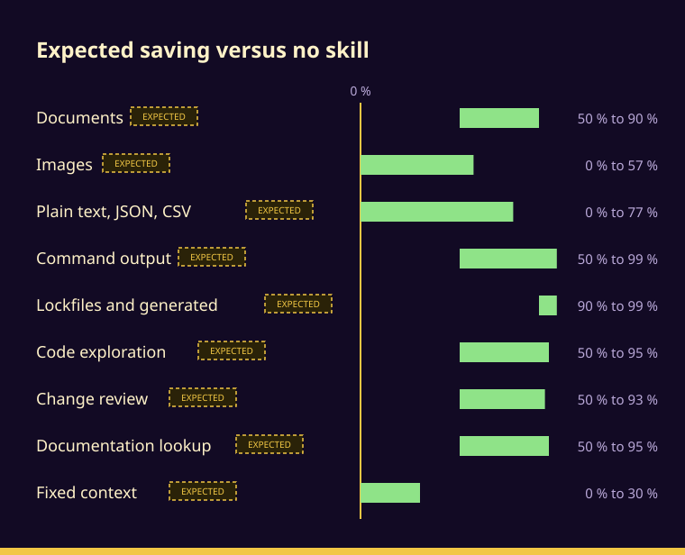

<p align="center"><br><sub>Token Diet cover: a Claude Code skill that saves tokens without lowering performance.</sub></p>

## Expected savings

<p align="center"><br><sub>Expected targets for the saving versus using no skill at all, net of the skill's own cost; these are not results. Real data today (estimates from runs on sample inputs, no agent runs; negative means the skill costs more than it saves): Documents (HTML only) 54% to 68%; Images −39% to 23%; Plain text, JSON, CSV −64% to 62%; Command output −98% to 99%; Code exploration −172% to 97%; Change review 3% to 87%; Documentation lookup 48% to 87%; Lockfiles and generated 74% to 99%; Fixed context −45% to 40%.</sub></p>

## Measurements

Each report gives the method, every case measured and the limits:

- [Documents](docs/measurements/documents.md)
- [Images](docs/measurements/images.md)
- [Plain text, JSON, CSV](docs/measurements/plain-text-json-csv.md)
- [Command output](docs/measurements/command-output.md)
- [Code exploration](docs/measurements/code-exploration.md)
- [Change review](docs/measurements/change-review.md)
- [Documentation lookup](docs/measurements/documentation-lookup.md)
- [Lockfiles and generated files](docs/measurements/lockfiles-and-generated.md)
- [Fixed context](docs/measurements/fixed-context.md)

## Main goal

The main goal is that, when the time comes, the `senior` skill sheds everything Token Diet already covers.

- When a Token Diet token-saving mechanic covers the same or more than the one in `senior`, `senior` drops its own.
- From then on `senior` depends on Token Diet being always installed, because without it `senior` would consume too much.
- Direction of the dependency: `senior` will depend on Token Diet; Token Diet will never depend on `senior`.

## Usage

```bash
python token-diet/scripts/convertir_fuentes.py report.pdf photo.png
python token-diet/scripts/consumo.py --repo .
python token-diet/scripts/compactar.py data.json server.log
python token-diet/scripts/resumir.py -- pytest -q
python token-diet/scripts/contexto.py
python token-diet/scripts/indexar_docs.py build
python token-diet/scripts/indexar_docs.py query hook blocks
```

`convertir_fuentes.py` writes Markdown and reduced images to `.token-diet/sources/`; read those, never the originals (`--max-px N` asks for a larger image). `consumo.py` audits what is loaded every session and says what to trim first; `--repo` adds the skills of a repository without installing them. `compactar.py` shrinks JSON (to a table when the rows are uniform), logs (WARN and ERROR with context, `--lines A-B` reads the original), lockfiles and generated files, and says what it may have lost. `resumir.py` runs a test, lint or build command and returns only the lines that matter; `contexto.py` gives the case file of a change (what it touches, who uses it, what to look at first); `estimar.py`, `relevar.py`, `impacto.py` and `duplicados.py` size, map and search a project without reading it. `indexar_docs.py` indexes documents and code symbols and answers a query with the section to open and what opening it costs; its `note` command keeps a continuity note with a token cap so a new session resumes without re-explaining the project.

To make the conversion mandatory and the continuity note automatic, install the skill and its hooks:

```bash
python instalar.py install
```

It copies the skill to `~/.claude/skills/token-diet/` and registers two hooks in `~/.claude/settings.json` (a backup is kept and the rest of the file is untouched): one blocks a `Read` of a PDF, Office document, image larger than 1024 px, or big lockfile or generated file and gives the exact command; the other loads the continuity note at the start of a session. `python instalar.py check` says whether the installed copy still matches this repository and `python instalar.py uninstall` removes both.

Emergency exits: `python token-diet/scripts/modo.py allow PATTERN` for one file, or `TOKEN_DIET_LECTURA_DIRECTA=1` for everything. A broken hook allows the read and logs the error in `.token-diet/hook-errors.log` (`TOKEN_DIET_HOOK_DEPURAR=1` shows it).
